# Apollo Healthcare Nurse Screening AI: Implementation & Route Architecture

> **Audience:** Senior Engineering & Product Review  
> **Target Use Case:** Apollo Healthcare Automated First-Round Nurse Screening & Clinical Assessment  
> **Status:** Deployed & Live on Render Web + LiveKit Cloud  

---

## 1. Context: Apollo Healthcare Nurse Screening Rounds

The application automates the **first-round screening and clinical qualification for hospital nurses** at Apollo Healthcare. Candidates are often on hospital premises, active duty wards, or noisy mobile environments. 

### Core Screening Objectives
* **Pre-Clinical Screening:** Captures city applied for, contact verification (with phone read-back), qualifications, graduation year, height/weight, and nursing exposure (ICU vs. general ward vs. fresher).
* **The Essential Care Gate (Diaper Care):** If a nurse candidate hesitates or refuses diaper care / essential hygiene tasks, the AI conversationally explains its clinical necessity, attempts up to two polite persuasions, and terminates the interview (`gate_failed`) before the clinical round if refused.
* **Dynamic Clinical Probing:** Rather than reading a static question list, an AI **Director** evaluates clinical depth in real time, challenging incomplete or contradictory answers (e.g., patient vitals, IV drip dosage, CPR protocols) and adapting follow-up questions dynamically.
* **Nurse Tiering & Scorecards:** Outputs structured candidate classification (`tier_1`, `tier_2`, `tier_3`, `needs_review`, `not_eligible`) with clear evidence-backed scorecards for HR recruiters.
* **Ward Noise & Multi-lingual Speech:** Designed to handle heavy ambient hospital noise, Indian regional languages, and code-mixed speech (Hinglish/Tanglish).

---

## 2. Architectural Comparison of the Two Routes

We deployed two distinct conversational architectures for A/B quality and latency benchmarking:

```mermaid
flowchart TD
    subgraph Route1["Route 1: ElevenLabs Expressive Cascade (/elevenlabs-interviewer)"]
        A1["Candidate Audio"] --> B1["LiveKit Room + Krisp Noise Cancellation"]
        B1 --> C1["STT: ElevenLabs Scribe v2\n(Fallback: OpenAI gpt-live-transcribe)"]
        C1 --> D1["Brain: GPT-4o Director (Analyst)\n+ GPT-4o-mini (Dialogue Engine)"]
        D1 --> E1["Expressiveness Engine\n(Injects [sigh], [pause], [umm])"]
        E1 --> F1["TTS: ElevenLabs v4 Turbo\n(Sarah EN / Alice Indic / Sujata)"]
        F1 --> G1["Candidate Ear (LiveKit WebRTC Audio)"]
    end

    subgraph Route2["Route 2: OpenAI GPT-Live Speech-to-Speech (/gpt-live-interviewer)"]
        A2["Candidate Audio"] --> B2["LiveKit Room + WebRTC Audio Stream"]
        B2 --> C2["OpenAI gpt-live-1\n(Native Full-Duplex Speech-to-Speech)"]
        C2 <--> D2["Director Steering\n(Client Delegation via append_commentary)"]
        C2 --> E2["Candidate Ear (Native Voice Stream)"]
    end
```

---

## 3. Route 1: `/elevenlabs-interviewer` (Expressive Cascade Pipeline)

* **URL:** `https://interviewai-418h.onrender.com/elevenlabs-interviewer`
* **Route Implementation:** [`client/src/App.tsx`](file:///c:/Users/dell/Desktop/Zain/InterviewAI/client/src/App.tsx#L42) mounts `<V2TestPage ttsProvider="elevenlabs" />`.
* **Backend Dispatch:** Flags session with `ttsProvider: "elevenlabs"`, mounted on LiveKit room metadata.

### Models & Flow
1. **Audio Ingestion & Noise Isolation:**
   * Uses **Krisp BVC / ai-coustics** within LiveKit to isolate candidate vocals and eliminate ward background chatter.
2. **Speech-to-Text (Ears):**
   * **Primary:** **ElevenLabs Scribe v2** streaming STT with medical keyterm priming (`IV drip`, `ICU`, `ward`, `staff nurse`).
   * **Automatic Fallback:** Gracefully fails over to **OpenAI `gpt-live-transcribe`** if Scribe websocket latency exceeds threshold.
3. **Brain & Clinical Director:**
   * **Director (GPT-4o):** Asynchronous per-turn clinical evaluator. Parses answers into structured JSON (clinical grade, contradictions, diaper gate status).
   * **Interviewer Voice (GPT-4o-mini):** Generates conversational replies steered by the Director's directives.
4. **Expressiveness Engine:**
   * Deterministic post-processor injects non-verbal audio cues (`[pause]`, `[sigh]`, `[umm]`) right before TTS.
   * **Transcript Split:** Clinical scoring sees clean text (`"Yes, I understand"`), while TTS synthesizes natural human speech (`"[pause] Yes, [umm] I understand"`).
5. **Text-to-Speech (Voice):**
   * **ElevenLabs `eleven_v4_turbo`** (~100ms first-audio latency).
   * Voices: `Sarah` (English premade), `Alice` (Indic premade), or `Sujata` (Indic native).

---

## 4. Route 2: `/gpt-live-interviewer` (Full-Duplex Speech-to-Speech)

* **URL:** `https://interviewai-418h.onrender.com/gpt-live-interviewer`
* **Route Implementation:** [`client/src/App.tsx`](file:///c:/Users/dell/Desktop/Zain/InterviewAI/client/src/App.tsx#L43) mounts `<V2TestPage voiceProvider="gpt_live" />`.
* **Agent Entrypoint:** Executes `_run_gpt_live_session` in [`agent/main.py`](file:///c:/Users/dell/Desktop/Zain/InterviewAI/agent/main.py#L1250).

### Models & Flow
1. **End-to-End Multimodal Speech:**
   * **Model:** **OpenAI `gpt-live-1`** (voice model: `marin`).
   * Bypasses the STT → LLM → TTS conversion chain. Audio streams straight into the model, which streams synthesized audio back in real time.
2. **Client Delegation Control (Clinical Governance):**
   * Multimodal speech models often drift off-topic if left unconstrained.
   * **Steering Mechanism:** Uses LiveKit client delegation. While candidate speech is streaming, our background **Director** calculates the next clinical move and calls `append_commentary(CONTROLLER DIRECTIVE)` to steer the conversation and enforce the diaper care gate.
3. **Turn-Taking & Interruption:**
   * Pauses, soft fillers, and backchannel acknowledgment (*"haan"*, *"go on"*) are handled organically by the neural audio model.
   * Hardware barge-in stops playback instantly if the candidate speaks over the agent.

---

## 5. Architectural Comparison Matrix

| Dimension | Route 1: ElevenLabs Cascade (`/elevenlabs-interviewer`) | Route 2: OpenAI GPT-Live (`/gpt-live-interviewer`) |
| :--- | :--- | :--- |
| **Pipeline Type** | Modular Cascade (`STT → LLM/Director → Expressive TTS`) | End-to-End Multimodal Speech-to-Speech |
| **STT Model** | ElevenLabs Scribe v2 (fallback: OpenAI streaming) | Native Builtin (`gpt-live-1`) |
| **TTS Model** | ElevenLabs `eleven_v4_turbo` | Native Builtin Voice (`marin`) |
| **End-to-End Latency** | ~750ms – 1.1s (Cascade + LiveKit transport) | **~350ms – 500ms** (Instant full-duplex) |
| **Clinical Governance** | **Very High:** Deterministic Flow engine directly controls every single prompt chunk. | **High:** Uses client delegation commentary directives to steer the live voice model. |
| **Indian Regional Language Fit** | **High:** ElevenLabs handles Indic accents well; Scribe handles medical Hinglish/code-mixing. | **Moderate:** English and Hindi sound fluid; Southern languages (Tamil, Telugu, Kannada) have less accent fidelity. |
| **Ward Noise Robustness** | **High:** LiveKit Krisp Voice Isolation cleans mic input before STT. | **Moderate to High:** Model has internal noise resilience, but ambient speech can confuse turn boundaries. |
| **Key Advantage** | Utmost clinical predictability, transcript split, and customizable regional voices. | Ultra-low conversational latency, human-like natural interruptions and organic backchanneling. |

---

## 6. Live Test Links for Validation

* **Baseline Cascade (Default):** [`https://interviewai-418h.onrender.com/v2/test`](https://interviewai-418h.onrender.com/v2/test)
* **ElevenLabs Expressive Route:** [`https://interviewai-418h.onrender.com/elevenlabs-interviewer`](https://interviewai-418h.onrender.com/elevenlabs-interviewer)
* **GPT-Live Full-Duplex Route:** [`https://interviewai-418h.onrender.com/gpt-live-interviewer`](https://interviewai-418h.onrender.com/gpt-live-interviewer)
