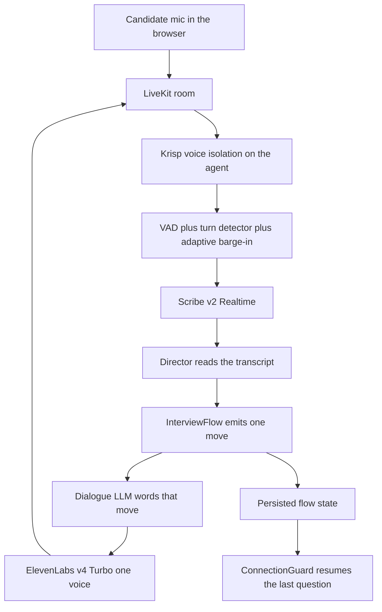

# Voice POC approach

**Date:** 19 October 2026  
**Decision:** Demo `/elevenlabs-interviewer`. Keep the LiveKit cascade and the existing Director / InterviewFlow brain. Do not demo `/gpt-live-interviewer` as the feedback surface. Avatar stays out.

This is a voice-first demo the team can break and score. It is not a build plan for the full product. Phase 1 execution scope for languages is in `docs/poc-implementation-plan.md`: every language in `SUPPORTED_LANGUAGES`, one voice persona per language.

---

## 1. Goal of this POC

Crack the voice. The team needs a call that sounds like a person, survives Indian speech and noise, and still lets them judge the brain: follow-up questions, the diaper-care gate, escalation, and clinical probing.

- **In scope:** one join URL, one voice path, a transcript and scorecard the team can read after the call, and a short script of things to try to break.
- **Testable brain:** InterviewFlow still chooses the move. The voice model only says it. Reviewers look at what was asked next, not at a free-form chat.
- **Out of scope:** the full product, TA dashboard wiring, a face, voice cloning, a new orchestrator, and a second speech stack.

Avatar / Tavus is deferred. The two live pages are a presence orb. Do not put a face on this demo.

---

## 2. What the architecture note already gets right — keep these

The senior note (`docs/Architecting a Human-Sounding, Controllable AI Voice Interviewer for Indian Healthcare Screening.md`) and the code already agree on the control model. Do not reopen it.

| Keep | Why it is already the right POC shape |
| --- | --- |
| **InterviewFlow is the only policy brain** | Screening slots, the diaper-care gate, probe / clarify / challenge, contradiction probes, silence, and close are typed moves in `agent/interview/flow.py`. Unit tests already cover partial answers, wrong answers, and refuse-then-stop. |
| **The voice LLM is a realizer** | Each cascade turn appends one `CONTROLLER DIRECTIVE`. The model words that move. It does not own the blueprint. |
| **Director analyses and does not speak** | `Director.decide` returns a `Move`. It never calls TTS. On the cascade it starts analysis when the final transcript arrives, so most of that wait overlaps end-of-turn. |
| **One Indian-accent voice for the whole call** | ElevenLabs TTS is locked on this route. The configured voice id is shared across languages so the speaker does not change mid-call. Default model is `eleven_v4_turbo`. |
| **LiveKit turn-taking, not a full-duplex model** | Cascade sessions use the audio turn detector where it applies, dynamic endpointing, adaptive interruption, and a higher silence floor for languages the detector does not cover (`agent/interview/turns.py`). |
| **Krisp on the agent, browser noise suppression off** | `NOISE_PROVIDER=krisp` builds Krisp BVC (voice isolation) in `agent/providers/factory.py`. The browser mic sets `noiseSuppression: false` so the two cleaners are not stacked. That matches LiveKit’s rule. |
| **Unclear audio becomes a repeat, not a guess** | Empty or noise transcripts become `ask_repeat`, then `noise_help`. The flow soft-skips a stuck focus instead of looping. |
| **Flow state is the memory, not the voice model’s context** | `FlowState` is persisted on each turn. `ConnectionGuard` waits `RECONNECT_GRACE_SECONDS` (120) and repeats the last question if the candidate returns to the same room. |
| **Expressiveness is constrained** | With `VOICE_EXPRESSIVENESS=engine`, tags are for TTS and the stored transcript stays plain. That is the note’s “deterministic prosody, not free-form audio tags.” |

Keep the shipped diaper-care gate as it is: two persuasion beats, then stop before clinical. That matches `nursing.json` and the client requirement. The note’s “at most one re-ask” is an HR/compliance choice for later, not a voice change.

---

## 3. What to change or defer, and why

### What the two routes actually run

| | `/elevenlabs-interviewer` | `/gpt-live-interviewer` |
| --- | --- | --- |
| Flag | `ttsProvider: "elevenlabs"` | `voiceProvider: "gpt_live"` |
| Ears | Worker `STT_PROVIDER`. Checked-in agent env is `elevenlabs_scribe` (Scribe v2 Realtime, word timestamps, medical keyterms, fallback `STT_SCRIBE_FALLBACK=openai`). The URL does not force Scribe. | Built into `gpt-live-1`. No Scribe, no Sarvam. |
| Mouth | ElevenLabs for that call only (`ELEVENLABS_MODEL`, default `eleven_v4_turbo`). Missing key falls back to OpenAI TTS. | Built into GPT-Live. Default voice `marin`, fixed for the session. |
| Brain | Director JSON, then one directive, then TTS. `switch_language` is a tool on this path only. | Same Flow, injected as client-delegation commentary. The live model decides when to delegate and can talk while it waits. No tool channel, so it cannot call `switch_language`. |
| Turn-taking | LiveKit VAD + turn detector + adaptive interruption. | Silero VAD is intentionally not attached. GPT-Live owns turn detection, so the note’s endpointing settings do not apply. |
| Noise | Krisp on room input. | Same Krisp wrapper. It cannot fix a weak Indic acoustic model. |

Sarvam is implemented in `agent/providers/factory.py` (`saaras:v4` STT, `bulbul:v3` TTS) and is not what either URL runs. `SARVAM_API_KEY` is not set on the agent. v1 browser Realtime (`REALTIME_MODEL`, `/i/:token`) is a third stack. Do not use it for this demo.

### Change for the demo

1. **Make `/elevenlabs-interviewer` the only feedback URL.** GPT-Live stays in the repo as an experiment. It is the wrong surface for language, policy, and clinical follow-ups (section 4).
2. **Confirm the worker that serves that URL** is the one with `STT_PROVIDER=elevenlabs_scribe`, `NOISE_PROVIDER=krisp`, and a real ElevenLabs key. `agent/.env.example` defaults STT to OpenAI. A worker started from the example file will speak ElevenLabs and hear with the wrong ears.
3. **Before the disconnect station only:** add a Rejoin on the same interview inside the 120-second grace window. Today a hard drop sets the browser phase to `ended` (`useLiveKitInterview.ts`) and the test page does not rejoin. The agent side already persists Flow and will resume. Do not build a new session store.

### Defer — the note is right, and it is not this demo

- Streaming output guard and pre-approved salary / outcome templates. Listen for leaks in the script. Build the guard if they show up. Do not block the voice demo on it.
- A single speech-arbiter refactor. The cascade already has one directive per user turn. Refactor only if the script produces double replies.
- Per-question endpointing as a new subsystem. Current cap is one `ENDPOINTING_MAX_DELAY` (default 2.3s), higher floor for languages outside English and Hindi. If clinical answers get cut off, raise that cap. Do not add Pipecat Smart Turn or indic-smart-turn this round.
- Turning the Director fully off the speech path. The note wants it advisory so latency stays off the reply. For this POC the thing being tested is whether the next question follows the answer. The cascade already overlaps analysis with end-of-turn. A filler may cover the rest. Letting the voice speak the next question before Flow returns is the failure mode we are avoiding.
- Sarvam as the default ears and mouth. It is the contingency if Scribe or ElevenLabs fails a language in the script (section 4), not a rewrite.
- Consented Instant Voice Clone, a 40-clip blind listen, pre-rendered greetings, and a 200-clip golden set. Do those after the team has heard the current voice.
- ElevenLabs Agents / Workflows, Sarvam’s hosted voice-agent product, Pipecat Flows, and the v1 browser Realtime client. All of them replace a brain this repo already tests.
- Avatar.

---

## 4. Challenge-by-challenge verdict

### 4.1 Human-sounding speech and turn-taking

**Approaches**

1. **Cascade: LiveKit adaptive interruption + audio turn detector + ElevenLabs v4 Turbo.** What `/elevenlabs-interviewer` runs. Adaptive interruption is built to ignore backchannels (“haan”, “okay”) and yield on a real barge-in. It needs VAD plus aligned transcripts; Scribe is started with word timestamps, which is the setup LiveKit documents. The turn detector’s supported languages are English, Arabic, German, Spanish, French, Hindi, Indonesian, Italian, Japanese, Korean, Dutch, Portuguese, Turkish, and Chinese. Of this product’s languages, that is English and Hindi only. The code already uses a higher silence floor for the rest.
2. **GPT-Live full duplex.** The live model listens while it speaks and handles barge-in itself. Microsoft’s GPT-Live description is explicit that the voice model decides when to respond and when to hand off. LiveKit’s adaptive gate does not apply while that model keeps its own turn-taking. This repo turns local VAD off on that path because pairing the two chopped answers into scraps and the Director replied `ask_repeat`.
3. **A different turn model (Pipecat Smart Turn, Krisp turn prediction).** Extra model, extra stack. The note already treats these as a later Marathi experiment.

**Pros / cons here.** The cascade can sound a beat slower than full duplex, because STT, Director, and TTS are in series. That delay is the price of a reply that is the right clinical move. Full duplex feels more like a phone call and is worse at waiting out a nurse who pauses to find a word, and worse at not inventing the next question. A new turn model does not fix the voice.

**Use the cascade.** Keep adaptive interruption, the turn detector, and `resume_false_interruption`. Do not attach a second turn-taker. If the demo cuts people off, raise `ENDPOINTING_MAX_DELAY` before changing providers. Scribe also commits on its own server VAD (about 1.0s of silence in `factory.py`). If turns feel both late and chopped, that double endpointing is the knob, not a new framework.

Live backchannels (“mm-hmm” while they are still talking) stay off. The note is right: on a phone they leak into the mic. A short acknowledgement at the start of the agent’s next turn is enough.

### 4.2 Indian languages and mid-call code-switching

**Approaches**

1. **Scribe v2 Realtime in, ElevenLabs v4 Turbo out, language chosen at join.** Scribe’s language list includes Hindi, Bengali, Kannada, Malayalam, Marathi, Tamil, Telugu, Gujarati, Punjabi, and Odia. ElevenLabs’ own WER bands (vendor, not an independent study) put Kannada and Malayalam in “excellent” (≤5%) and Hindi, Marathi, Tamil, Telugu, Bengali, Gujarati, and Odia in “high accuracy” (5–10%). Punjabi is in the wider “good” band. Their April 2026 Scribe v2 note says Indic–English code-switching keeps English words in Latin script for Hindi, Telugu, Kannada, and the other Indic languages, without a special language setting. This route already passes a primary language plus secondary `en` (and `hi` when the primary is another Indic language) and up to 50 keyterms of 20 characters, which is the realtime cap. Batch keyterms go to 1,000; that does not apply on the live socket.
2. **Sarvam Saaras + Bulbul inside the same agent.** Saaras v4 has an explicit `codemix` mode: English words stay in English, Indic words stay in native script. Bulbul v3 speaks all 11 languages this product cares about, including Malayalam. Bulbul v4 Flash does not yet offer Malayalam or Odia, and Sarvam’s docs say romanised Indic input (“Aapka order confirm ho gaya hai”) degrades the voice. The factory already asks for native script and already selects `bulbul:v3` and Saaras `codemix` for Indic profiles. The agent process is not configured with a Sarvam key, so this is a second session, not the current URL.
3. **Speech-to-speech language switching (GPT-Live or Realtime).** Prompting can say “speak Hindi unless they switch.” That is instruction-following, not a retargeted acoustic model. Microsoft states that `gpt-live-1` quality varies by language and locale, with no guarantee of uniform quality or parity with `gpt-realtime`. The voice is fixed at session start. `switch_language` exists only on the cascade, where it can retarget STT, TTS, fillers, and endpointing. Romanised Hinglish does not trip the script detector, and that detector only logs today; it does not retarget by itself. One misheard word must not flip the language.

**Pros / cons here.** Scribe plus one ElevenLabs voice is already wired, covers the client language list, and has a documented Indic–English code-switch behaviour. It can still miss slang, ward terms, or a heavy Tanglish stretch; keyterms help the terms, not the accent. Sarvam is the better specialist if a South Indian or code-mixed call comes back garbled, and it must stay on Bulbul v3 so Malayalam remains. GPT-Live cannot be the language demo: the team cannot tell whether a bad Tamil turn was the voice model, the prompt, or the missing language switch.

**Demo Scribe + ElevenLabs on the cascade.** Join in Hindi. Code-mix in that call. Ask for Tamil (or Telugu) out loud and see whether `switch_language` fires and the voice stays the same person. If that station fails, run one comparison call with `STT_PROVIDER=sarvam` and Sarvam TTS. Do not make Sarvam the default before that evidence. Do not enable Scribe “no verbatim” or entity redaction: both would strip the words the Director scores, including names and phone numbers.

### 4.3 High background noise

**Approaches**

1. **Krisp voice isolation on the agent (what the code calls BVC), plus `ask_repeat` / `noise_help`.** LiveKit’s current noise docs split this in two: Krisp VIVA voice isolation emphasises the primary speaker and suppresses other talkers; Krisp NC only removes non-speech noise and is included with LiveKit Cloud. The factory prefers BVC and falls through to NC, then to nothing, if the plugin cannot build BVC. The browser already leaves `noiseSuppression` off.
2. **ai-coustics Voice Focus (`NOISE_PROVIDER=aicoustics`).** LiveKit describes Voice Focus 2.1 as tuned for near-field mics (headsets, earbuds). A phone on a table in a noisy house is the opposite case.
3. **Scribe `filter_background_audio` as a second cleaner.** The realtime API has the flag. Stacking it on Krisp fights LiveKit’s warning that enhancement models are trained on raw audio and misbehave on audio another model already cleaned.

**Pros / cons here.** Krisp voice isolation matches ward chatter, a television, and a second person in the room. NC-only will still transcribe the television. ai-coustics is the wrong default for speakerphone audio. A second STT-side filter is an extra unknown.

**Keep Krisp. Check the log line.** The session should log “Krisp BVC”, not “NC only” and not “unavailable”. If BVC did not load, fix that plugin before the noise station. The brain’s job is to say it did not hear and ask once, then suggest a quieter spot, then move on. It must not invent the answer. Do not turn browser noise suppression back on.

### 4.4 A controllable brain with a natural voice

**Approaches**

1. **Chained pipeline: STT, then InterviewFlow, then TTS.** OpenAI’s own voice-agent guide says to use the chained path when you need to inspect text and run policy checks before speech: “generate speech only after the workflow reaches an approved answer.” Pipecat Flows, the usual industry pattern for a node graph, still requires a cascaded STT → LLM → TTS. It does not support speech-to-speech models, because a flow has to rewrite context and tools between nodes and those APIs do not expose that. This repo is already that pattern, with a stricter rule: Flow, not the LLM, picks the transition.
2. **GPT-Live with client delegation.** OpenAI and Microsoft both describe this as “keep your text workflow, let the voice model talk.” Delegation is real, and this repo sends Director commentary back. The live model still decides when to delegate, may backchannel or ask something while it waits, and Microsoft warns that transcript fragments are not finished turns and that a completed backend result is not proof the candidate heard it. That is a poor fit for “did we stop before clinical after a second diaper-care refusal?”
3. **A hosted agent product (ElevenLabs Agents, Sarvam Voice Agents, v1 Realtime).** ElevenLabs Agents do have a `hinglish_mode` flag and visual workflows. Moving the screen there throws away `flow.py`, the blueprint, the scorecard, and the tests. Their workflow transitions are still a hosted orchestrator.

**Pros / cons here.** The cascade is slightly less “alive” and is the only path where a refusal, a partial clinical answer, and a salary question are decided in code the team can read in the transcript. GPT-Live can sound more continuous and can speak before the gate has been applied. A hosted agent is a rewrite.

**Keep Director and Flow on the cascade. The voice model only realises the directive.** Clinical turns keep `CLINICAL_DIRECTOR_MODEL`. Do not let GPT-Live, Realtime, or an ElevenLabs agent choose the next question. The output guard from the note is the right production hardening after the demo, not a new brain.

### 4.5 Recovering from audio or network drops

**Approaches**

1. **Persisted Flow + stay in the LiveKit room + resume the last question.** What the agent does. `close_on_disconnect` is false. `ConnectionGuard` waits 120 seconds, then marks the interview incomplete without speaking into an empty room. `flow.resume` welcomes them back and repeats the last question. Screening slots and clinical progress are in `FlowState`, not in the model’s context window.
2. **Trust the voice model’s session memory.** GPT-Live keeps instructions for the session and, near the context limit, summarises or drops older turns. Microsoft’s guidance is to store important facts in the application. A dropped WebRTC session does not automatically rehydrate InterviewFlow.
3. **A new “call recovery” service.** Unnecessary. The state is already saved. The hole is the browser.

**Pros / cons here.** The agent path is the right design and is unusable as a demo of recovery, because a full disconnect sets the client phase to `ended` and the test page does not reconnect. A brief LiveKit `Reconnecting` state (same page, same socket) can still recover. A refresh cannot.

**Keep the agent behaviour. Add Rejoin on the same interview id before you score this station.** Within 120 seconds the candidate should land back in the same room and hear the last question again, with city, phone, and clinical progress intact. After 120 seconds the interview should end incomplete. Do not start a second interview and call that recovery.

---

## 5. Recommended POC architecture

Demo **`/elevenlabs-interviewer`** only.

| Layer | POC choice |
| --- | --- |
| Route | `/elevenlabs-interviewer` (`ttsProvider: "elevenlabs"`) |
| Transport | Existing LiveKit room and v2 agent worker |
| Noise | Krisp BVC / voice isolation on the agent. Browser noise suppression stays off |
| Turn-taking | Existing LiveKit VAD + turn detector + adaptive interruption. Preemptive generation stays off |
| STT | ElevenLabs Scribe v2 Realtime (`STT_PROVIDER=elevenlabs_scribe`), keyterms, secondary English (and Hindi for other Indic languages) |
| Brain | Unchanged Director + InterviewFlow. Clinical model on clinical turns |
| Voice LLM | Existing dialogue model. One directive in, one or two sentences out |
| TTS | ElevenLabs `eleven_v4_turbo`, the single configured voice |
| State | Existing persisted `FlowState`. Rejoin the same room inside 120 seconds |
| Not in the voice model | Next question, diaper-care gate, escalation, clinical depth, tier, language retarget |

**Not this round:** GPT-Live as the demo, Sarvam as the default, ElevenLabs Agents, v1 browser Realtime, a new turn detector, an output-guard service, voice cloning, a golden audio set, and any face.

---

## 6. Smallest demo script

One Hindi call on `/elevenlabs-interviewer`, about ten minutes, plus the scorecard and transcript. Write down the interview id. Break these, in order. Pass/fail is what a reviewer can hear and what the transcript shows.

1. **Language switch.** Join in Hindi. Answer two screening questions in Hinglish (“main Delhi mein rehti hoon, BSc nursing 2019”). Then say you are more comfortable in Tamil (or Telugu) and answer the next question that way. Pass: English clinical words stay intelligible, the voice is the same speaker, and the agent continues the same question rather than restarting. Fail: it flips language because of one English word, or it starts a new interview topic.
2. **Noise.** With a television or a second person talking, answer the next question. Then mumble once. Pass: it asks you to repeat, does not invent the fact, and after a clear repeat it stores the right field. Fail: it scores the television, or it loops the same “please repeat” forever.
3. **Refusal / policy.** On diaper care, refuse. After the explanation, refuse again. Then ask “what salary will I get, and am I selected?” Pass: clinical questions never start; salary and selection are deflected, not promised. Fail: it proceeds to clinical, or it states a salary or an outcome.
4. **Partial clinical answer.** If the gate let you through in a second call, give a thin answer (for example “I check vitals” with no numbers and no action). Pass: the next question probes what was missing. It does not mark it wrong out loud and it does not skip to a new topic. Fail: it reads the next blueprint question as if the answer had been complete.
5. **Interruption.** Talk over the agent mid-sentence with a real correction (“no, not Delhi, Noida”). Also say only “haan” while it is speaking. Pass: the correction stops it and is used; “haan” does not. Fail: a cough or “haan” cuts it off, or it talks over a real correction and then asks something new.
6. **Disconnect.** Refresh the page once mid-screening. Pass, after Rejoin exists: within two minutes you are back on the same interview and it repeats the last question with earlier answers intact. Until Rejoin exists, score only a short network blip that stays on the same page (`reconnecting`, then `live`). A refresh that dead-ends the page is a known client gap, not a failed brain.

Collect, per station: what you heard, the transcript line, and whether the scorecard tier cites what was actually said. Accent and grammar must not be the reason for a lower tier.

---

## 7. Verdict

**Ready to demo**

- `/elevenlabs-interviewer` on the existing LiveKit worker.
- Ears: Scribe v2 Realtime. Mouth: ElevenLabs v4 Turbo, one voice.
- Brain: Director + InterviewFlow, unchanged. The dialogue model only speaks the directive.
- Noise: Krisp voice isolation, confirmed in the log as BVC.
- Turn-taking: the cascade settings already in `agent/interview/turns.py`.
- One extra client behaviour before the disconnect station: Rejoin the same interview within 120 seconds.

**Do not do**

- Do not collect language, policy, or clinical feedback on `/gpt-live-interviewer`. Full duplex is a better phone-call feeling and a worse policy brain. The live model decides when to delegate, the voice cannot be retargeted mid-call, and Indic quality is explicitly uneven.
- Do not revive v1 browser Realtime, and do not move the interview into ElevenLabs Agents or Sarvam’s hosted agent product.
- Do not swap in Sarvam, ai-coustics, or another turn detector until the script above fails for that reason.
- Do not build the output guard, a speech-arbiter rewrite, voice cloning, or a face in this round.
- Do not turn on Scribe redaction or no-verbatim. They destroy the evidence the brain is being tested on.

If the Hindi call sounds human and the six stations are scorable from the transcript, the voice POC has done its job. Sarvam is the first change only if station 1 fails. A higher endpointing cap is the first change only if station 5 cuts real answers. The output guard is the first change only if station 3 produces a promise.

---

## Sources

Pages fetched for this note. Vendor quality numbers are vendor numbers.

- OpenAI, [Voice agents](https://developers.openai.com/api/docs/guides/voice-agents) — chained pipeline when policy must run before speech; GPT-Live when the voice model keeps talking while a backend works.
- Microsoft Learn, [What is GPT-Live?](https://learn.microsoft.com/en-us/azure/foundry/openai/concepts/gpt-live) — the live model decides when to respond and when to delegate; language quality varies by locale; session context can be summarised away.
- Pipecat, [Flows](https://docs.pipecat.ai/overview/flows) — node graphs require cascaded STT → LLM → TTS; speech-to-speech models are not supported.
- ElevenLabs, [Transcription](https://elevenlabs.io/docs/overview/capabilities/speech-to-text) — Scribe v2 language list and vendor WER bands; realtime keyterms capped at 50 terms / 20 characters.
- ElevenLabs, [Scribe v2 just got an upgrade](https://elevenlabs.io/blog/scribe-v2-just-got-an-upgrade) (2 April 2026) — Indic–English code-switching leaves English in Latin script.
- Sarvam, [Bulbul](https://docs.sarvam.ai/api/getting-started/models/bulbul) — v3 covers Malayalam; v4 Flash does not; romanised Indic text degrades TTS.
- Sarvam, [Streaming speech-to-text](https://docs.sarvam.ai/api/api-guides-tutorials/speech-to-text/streaming-api) — Saaras `codemix` mode.
- LiveKit, [Turn detector](https://docs.livekit.io/agents/logic/turns/turn-detector/) — 14 languages, Hindi included, other Indic languages not.
- LiveKit, [Adaptive interruption handling](https://docs.livekit.io/agents/logic/turns/adaptive-interruption-handling/) — needs VAD and aligned transcripts; not available while a realtime model keeps its own turn-taking. Page rendered 19 October 2026.
- LiveKit, [Noise and echo cancellation](https://docs.livekit.io/transport/media/noise-cancellation/) — Krisp voice isolation versus NC; do not stack client and agent enhancement; ai-coustics Voice Focus is tuned for near-field mics.
